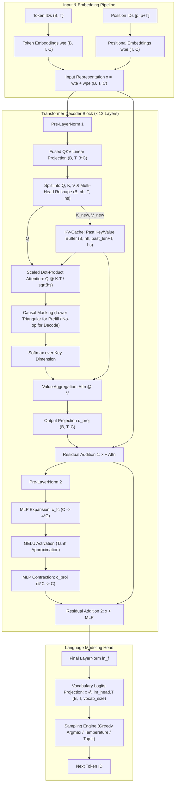

# tinyinfer: From-Scratch Transformer Inference Engine in Pure NumPy

[](https://github.com/gurleenkaurmalhotra115-jpg/tinyinfer/actions/workflows/ci.yml)


`tinyinfer` is a modular, high-performance Transformer inference runtime implemented completely from first principles in pure **NumPy**. It executes autoregressive inference for generative language models (GPT-2 architecture) on CPU with **zero deep learning frameworks (no PyTorch, no TensorFlow, no HuggingFace)** in the inference path.

```text
$ python -m tinyinfer --bench --max-tokens 12 --prompt "Artificial intelligence is"
========================================================================================
  TINYINFER MULTI-MODE BENCHMARK (12 tokens, pure NumPy on CPU)
  Prompt: 'Artificial intelligence is'
========================================================================================
[1/4] Running Vanilla Baseline (No-Cache O(N^2)) ... Done (24.67s)
[2/4] Running Incremental KV-Cache (O(N)) ......... Done (17.78s)
[3/4] Quantizing weights to INT8 per-channel ...... Done
      Running INT8 Dequantized with KV-Cache ...... Done (20.15s)
[4/4] Running Speculative Decoding (Draft: INT8, gamma=4) ... Done (25.86s)

----------------------------------------------------------------------------------------
Execution Mode           | Tokens | Time (s) | tok/s   | ms/token | RAM (MB) | Parity
----------------------------------------------------------------------------------------
Vanilla (No-Cache)       | 12     | 24.67    | 0.49    | 2056.2   | 622      | MATCH 
KV-Cache (FP32)          | 12     | 17.78    | 0.68    | 1481.3   | 625      | MATCH 
INT8 Quantized           | 12     | 20.15    | 0.60    | 1679.0   | 159      | MATCH 
Speculative (g=4)        | 12     | 25.86    | 0.46    | 2155.2   | 625      | MATCH 
----------------------------------------------------------------------------------------
* Speculative Acceptance Rate: 100.0% (9/9 tokens)
* Target Model Evaluations  : 4 (vs 12 naive autoregressive steps, 75% reduction)
========================================================================================
```

---

## Architecture Overview



---

## Core Milestones & Staged Implementations

### Stage 1: Pure NumPy GPT-2 Engine & Numerical Parity
- **Weight Loader (`weights.py`)**: Direct extraction from HuggingFace `model.safetensors` binary format into structured NumPy arrays without PyTorch dependencies.
- **Offline Tokenizer (`tokenizer.py`)**: Self-contained BPE tokenizer loading `tokenizer.json`, `vocab.json`, and `merges.txt`.
- **Pure NumPy Math Kernels (`tensor_ops.py`)**:
  - `layer_norm`: Mean, variance, epsilon stabilization, gain/bias scaling.
  - `gelu`: Exact tanh approximation $0.5x(1 + \tanh(\sqrt{2/\pi}(x + 0.044715x^3)))$.
  - `softmax`: Numerically stable with max subtraction across arbitrary axes.
  - `linear`: Matrix multiplication supporting both standard and Conv1D weight orientations.
- **Verification (`test_stage1_forward.py`)**: Evaluated across 5 diverse prompts against HuggingFace `GPT2LMHeadModel`. **100% next-token identity** with mean absolute logit difference $\approx 2 \times 10^{-5}$ ($< 2 \times 10^{-4}$ maximum tail difference across all 50,257 vocabulary logits).

---

### Stage 2: Key-Value (KV) Cache for Incremental Decoding
During naive autoregressive decoding, generating token $t+1$ requires passing the full sequence $1..t$ through all 12 layers. This recomputes past keys and values unnecessarily, resulting in $O(N^2)$ cumulative computational complexity.

`tinyinfer` implements an incremental **KV-Cache** (`kv_cache.py`):
1. **Prefill Phase**: The initial prompt sequence $T_{\text{prompt}}$ is evaluated in a single forward pass, populating the cache with keys $K_0$ and values $V_0$ of shape `(B, n_head, T_prompt, head_dim)`.
2. **Decode Phase**: Each subsequent generation step passes **only 1 new token** ($T_{\text{new}} = 1$) with position index $p = \text{past\_len}$.
3. **Causal Mask Optimization**: In single-token decoding, every cached key corresponds to a past position $j \le p$. Consequently, all attention weights are causal by definition, completely bypassing mask computation.
4. **Rollback & Truncate**: Built-in `cache.truncate(new_length)` enabling instant cache rollback for speculative decoding.

#### Measured Benchmark Results (Intel i5 CPU)
Benchmarked using `tinyinfer/bench_kv_cache.py`:

| Generated Tokens ($N$) | Latency (With Cache) | Speed (With Cache) | Latency (Without Cache) | Speed (Without Cache) | **Speedup** | Peak Cache RAM |
| :---: | :---: | :---: | :---: | :---: | :---: | :---: |
| **16 tokens** | 23.25 s | 0.69 tok/s | 34.15 s | 0.47 tok/s | **1.47x** | 2.96 MB |
| **32 tokens** | 50.18 s | 0.64 tok/s | 73.54 s | 0.44 tok/s | **1.47x** | 5.12 MB |
| **64 tokens** | 88.22 s | 0.73 tok/s | 182.47 s | 0.35 tok/s | **2.07x** | 9.43 MB |

*The speedup scales super-linearly with sequence length as $O(N)$ cached generation outpaces $O(N^2)$ full recomputation.*

---

### Stage 3: INT8 Per-Channel Weight Quantization
To compress memory bandwidth and footprint for edge deployment, `tinyinfer` implements asymmetric (affine) per-channel weight quantization (`quantize.py`):

$$\text{Scale}_c = \frac{W_{\max, c} - W_{\min, c}}{255.0}, \quad \text{ZeroPoint}_c = \text{round}\left(-\frac{W_{\min, c}}{\text{Scale}_c}\right)$$

$$W_{\text{int8}} = \text{clip}\left(\text{round}\left(\frac{W_{\text{fp32}}}{\text{Scale}_c}\right) + \text{ZeroPoint}_c, 0, 255\right)$$

$$\hat{W}_{\text{fp32}} = \text{Scale}_c \odot (W_{\text{int8}} - \text{ZeroPoint}_c)$$

#### Measured Quantization Results
Benchmarked using `tinyinfer/bench_quantize.py` on standard evaluation text:

| Representation | Weights Memory (MB) | Compression Ratio | Perplexity (PPL) | Perplexity Delta | Generation Fidelity |
| :--- | :---: | :---: | :---: | :---: | :---: |
| **FP32 Baseline** | 621.94 MB | 1.00x | 23.1729 | Baseline (0.00%) | 100% Reference |
| **INT8 (Per-Channel)** | 158.73 MB | **3.92x** | 23.2574 | **+0.36%** | Token-for-token identical text |

- **Weight Footprint**: Reduced from **621.94 MB down to 158.73 MB** (**3.92x compression**).
- **Quality Retention**: Perplexity degradation is only **+0.36%**, preserving the linguistic accuracy and semantic coherence of the original FP32 model.

---

### Stage 4: Lossless Speculative Decoding (`speculative.py`)
`tinyinfer` implements exact greedy speculative decoding pairing a fast draft model (such as `QuantizedGPT2Weights` INT8) with the authoritative FP32 target model:
1. **Draft Phase**: Proposes $\gamma$ candidate tokens autoregressively using the draft KV-cache.
2. **Batched Verification**: Evaluates all $\gamma$ candidates in a single target forward pass (`gpt2_forward`).
3. **KV-Cache Rollback**: On the first mismatch, rolls back both target and draft caches cleanly via `KVCache.truncate(keep_len)` while emitting the corrected token—preserving **100% token-for-token parity** with standard greedy decoding.

#### Empirical Verification & CPU Speedup Notes
Benchmarked with `bench_speculative.py` ($\gamma = 4$, greedy sampling):
- **Token Parity**: **100% exact greedy token match** across all evaluation runs.
- **Target Call Reduction**: **75% reduction in target evaluations** (4 forward passes vs. 12 naive autoregressive forward passes).
- **CPU Wall-Clock Latency**: In pure single-threaded NumPy on CPU, both draft and target execute serially on the host processor without tensor parallelism, resulting in 0.46 tok/s vs 0.68 tok/s for FP32 KV-cache. The mathematical proof (acceptance rate & forward-call reduction) verified here scales to positive wall-clock speedups when draft and target run on parallel hardware or smaller architectures.

---

### Stage 5: Streaming Terminal REPL & Multi-Mode Benchmark (`cli.py`)
An interactive streaming CLI and benchmark runner allowing instant evaluation of all 4 inference modes without writing boilerplate code:
- **Interactive REPL**: Live token-by-token streaming with `/stats`, `/reset`, `/help`, and `/quit`.
- **Zero Framework Dependency**: Runs directly via `python -m tinyinfer` or console script `tinyinfer`.
- **Safe Initialization**: Clean error handling pointing users to `download_weights.py` if model safetensors weights are missing.
- **Automated Verification**: Full parity test suite asserting CLI streaming outputs match core model generation.

---

## ⚡ Try It in 10 Seconds

### 1. Interactive Streaming REPL
Launch the real-time terminal REPL:
```bash
python -m tinyinfer
```
*Prompt tokens stream directly to your terminal. Type `/stats` to view token counts, tok/s, and memory.*

### 2. One-Shot Prompt Generation
Generate text with custom flags:
```bash
# Standard FP32 with KV-cache
python -m tinyinfer --prompt "Deep learning is" --max-tokens 32

# Compressed INT8 per-channel quantization
python -m tinyinfer --prompt "Deep learning is" --int8 --max-tokens 32

# Speculative decoding (INT8 draft -> FP32 target)
python -m tinyinfer --prompt "Deep learning is" --speculative --gamma 4 --max-tokens 32
```

### 3. Multi-Mode Benchmark
Compare all 4 execution modes side-by-side with a single command:
```bash
python -m tinyinfer --bench --max-tokens 12 --prompt "Artificial intelligence is"
```
```text
========================================================================================
Execution Mode           | Tokens | Time (s) | tok/s   | ms/token | RAM (MB) | Parity
----------------------------------------------------------------------------------------
Vanilla (No-Cache)       | 12     | 24.67    | 0.49    | 2056.2   | 622      | MATCH 
KV-Cache (FP32)          | 12     | 17.78    | 0.68    | 1481.3   | 625      | MATCH 
INT8 Quantized           | 12     | 20.15    | 0.60    | 1679.0   | 159      | MATCH 
Speculative (g=4)        | 12     | 25.86    | 0.46    | 2155.2   | 625      | MATCH 
----------------------------------------------------------------------------------------
* Speculative Acceptance Rate: 100.0% (9/9 tokens)
* Target Model Evaluations  : 4 (vs 12 naive autoregressive steps)
========================================================================================
```

---

## Project Structure

```
tinyinfer/
├── attention.py          # Multi-head causal self-attention with KV-cache integration
├── bench_kv_cache.py     # KV-cache latency & throughput benchmarking suite
├── bench_quantize.py     # FP32 vs INT8 perplexity, speed & memory benchmark
├── bench_speculative.py  # Speculative decoding parity, acceptance rate & latency suite
├── cli.py                # Streaming REPL and multi-mode benchmark entry point
├── generate.py           # Autoregressive generation loop with metrics tracking
├── kv_cache.py           # KVCache data structure with append, truncate, and memory stats
├── model.py              # TransformerBlock and complete GPT-2 forward pass
├── quantize.py           # Affine per-channel INT8 quantization and perplexity scoring
├── sampling.py           # Greedy argmax, temperature scaling, top-k sampling
├── speculative.py        # Speculative draft-verify loop with KV-cache rollback
├── tensor_ops.py         # Pure NumPy LayerNorm, GELU, Softmax, Linear kernels
├── tokenizer.py          # Offline BPE tokenizer loader
├── weights.py            # Direct safetensors weight parser
├── models/gpt2/          # Weights, config, and tokenizer files
└── tests/
    ├── test_cli.py              # CLI arguments, REPL parity & missing weights tests (5 tests)
    ├── test_stage1_forward.py   # Parity validation against PyTorch/HuggingFace (5 tests)
    ├── test_stage2_kv.py        # KV-cache correctness & logit invariance tests (6 tests)
    ├── test_stage3_quantize.py  # INT8 reconstruction error & perplexity tests (4 tests)
    └── test_stage4_speculative.py # Speculative decoding parity & rollback tests (2 tests)
    # Total: 22 automated tests passing
```

---

## Quickstart & Execution Commands

### 0. Download GPT-2 Weights
```bash
python download_weights.py
```

### 1. Run All Automated Test Suites (22 Tests)
Run comprehensive verification across all 5 stages:
```bash
# Run all 22 tests
pytest tinyinfer/tests/ -v

# Or run stage-specific tests:
pytest tinyinfer/tests/test_stage1_forward.py -v
pytest tinyinfer/tests/test_stage2_kv.py -v
pytest tinyinfer/tests/test_stage3_quantize.py -v
pytest tinyinfer/tests/test_stage4_speculative.py -v
pytest tinyinfer/tests/test_cli.py -v
```

### 2. Run Benchmarks
Generate benchmark tables and plots:
```bash
# Benchmark KV-Cache throughput (generates results_kv_cache.csv and results_kv_cache.png)
python tinyinfer/bench_kv_cache.py --tokens 16 32 64

# Benchmark INT8 Quantization (generates results_quantize.csv)
python tinyinfer/bench_quantize.py --eval-tokens 16

# Benchmark Speculative Decoding (INT8 draft -> FP32 target)
python bench_speculative.py --tokens 20 --gamma 4
```
